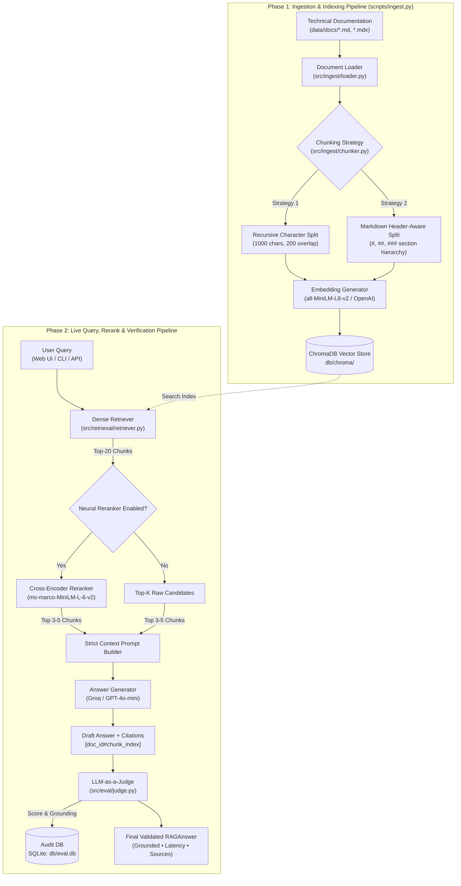

# ⚡ DocsRAG

<p align="center">
  <strong>Production-Grade Retrieval-Augmented Documentation Assistant</strong><br>
  <em>Featuring Dual Chunking Strategies, Neural Cross-Encoder Reranking, Strict Citations, and LLM-as-a-Judge Verification</em>
</p>

<p align="center">
  <a href="https://www.python.org/downloads/"></a>
  <a href="https://fastapi.tiangolo.com/"></a>
  <a href="https://www.trychroma.com/"></a>
  <a href="https://huggingface.co/sentence-transformers"></a>
  <a href="https://groq.com/"></a>
  <a href="https://docs.pydantic.dev/"></a>
  <a href="https://docs.pytest.org/"></a>
</p>

---

## 📸 Output & Web Interface

DocsRAG includes a built-in, dark-canvas engineering Web UI for live querying, dynamic pipeline reconfiguration, and real-time verification telemetry.

<p align="center">
  
</p>

<p align="center"><em>DocsRAG Web Interface: Live document retrieval, chunking strategy comparison, neural reranker toggle, inline source citations, groundedness validation, and sub-second latency telemetry.</em></p>

---

## 🌟 Overview

**DocsRAG** is a production-style, end-to-end Retrieval-Augmented Generation (RAG) system engineered to answer complex questions across technical documentation repositories (e.g., LangChain docs) with **mathematically verified, cited, and schema-validated responses**.

Standard RAG architectures frequently hallucinate, retrieve irrelevant chunks, or fail to substantiate claims. DocsRAG solves this by implementing an **"Open-Book Examination"** paradigm:
1. **Two-Stage Ingestion:** Implements both **Recursive Character Splitting** and **Markdown Header-Aware Semantic Splitting**.
2. **Dense Vector Search:** Embeds documents into persistent **ChromaDB** collections via `all-MiniLM-L6-v2` (local) or `text-embedding-3-small` (OpenAI).
3. **Cross-Encoder Neural Reranking:** Eliminates false positives by rescoring retrieved pairs with `cross-encoder/ms-marco-MiniLM-L-6-v2`.
4. **Strict Context-Grounding:** Synthesizes answers under zero-hallucination prompts with inline chunk-level citations (`[file.md#chunk]`).
5. **LLM-as-a-Judge Verification:** A secondary evaluator automatically audits every response against source context to compute a factual **groundedness score** (0.0 to 1.0).
6. **Autonomous Agent Mode:** Multi-turn tool-calling loop (`retrieve_docs`) for iterative multi-hop reasoning.

---

## 🚀 Key Features

| Feature | Description | Component |
|---|---|---|
| **Dual Chunking Pipeline** | Switch between fixed-size recursive chunking (`1,000` chars, `200` overlap) and structural header-aware chunking (`#`, `##`, `###`). | `src/ingest/chunker.py` |
| **Dense Vector Retrieval** | High-performance embedding and cosine similarity search over vector collections. | `src/retrieval/retriever.py` |
| **Neural Cross-Encoder** | Deep relevance reranking using `ms-marco-MiniLM-L-6-v2` to filter top candidates before generation. | `src/retrieval/reranker.py` |
| **Grounded Answer Generator** | OpenAI `gpt-4o-mini` or ultra-fast free `Groq` (`llama-3.3-70b-versatile`, `qwen`) generation with strict source citation rules. | `src/generation/generator.py` |
| **LLM-as-a-Judge** | Automated fact-checking evaluator that audits answers against source chunks and computes faithfulness. | `src/eval/judge.py` |
| **Autonomous Agent Loop** | Multi-hop iterative reasoning using OpenAI function-calling with the `retrieve_docs` tool. | `src/agent/loop.py` |
| **Full Audit Trail** | Persistent SQLite store logging every query, answer, grounding verdict, and latency profile. | `src/eval/logger.py` |
| **Modern Web Dashboard** | Responsive, zero-dependency dark-mode interface with live pipeline controls and markdown rendering. | `src/api/index.html` |
| **Production REST API** | Fully typed FastAPI endpoints with Pydantic v2 schemas and interactive Swagger UI (`/docs`). | `src/api/main.py` |

---

## 🏗️ System Architecture

DocsRAG operates across two coordinated phases: **Ingestion (Offline Indexing)** and **Query (Real-Time Retrieval & Verification)**.



---

## 🕹️ Interaction Modes

DocsRAG offers four distinct ways to interact with the system:

### 1. Interactive Web UI
Launch the server and open `http://localhost:8000` in your browser. The web interface provides:
- Live strategy switching: **Recursive** vs. **Header-Aware**.
- Toggleable **Neural Cross-Encoder Reranker**.
- Dynamic **Top-K Context Depth** slider.
- Collapsible source citations displaying raw chunk text and match scores.
- Real-time telemetry indicators (Groundedness pill, query latency in ms).

### 2. Command-Line Assistant (`ask.py`)
Query the documentation instantly from your terminal without opening a browser:

```bash
# Direct one-shot question
python ask.py "How do I install LangChain?"

# Interactive terminal session
python ask.py
```

```text
============================================================
ANSWER:
============================================================
To install LangChain, you can use either pip or conda:

Pip: pip install langchain
Conda: conda install langchain -c conda-forge
============================================================
Grounded in Docs: True | Latency: 479 ms
Sources cited (2):
  • [get_started/installation.mdx#0] (score: 0.92)
  • [get_started/installation.mdx#1] (score: 0.88)
============================================================
```

### 3. REST API (`/ask`)
Send HTTP requests via `curl` or any HTTP client:

```bash
curl -X POST http://localhost:8000/ask \
  -H "Content-Type: application/json" \
  -d '{
    "question": "What is LCEL?",
    "chunking": "header_aware",
    "use_reranker": true,
    "top_k": 5
  }'
```

### 4. Autonomous Agent Loop (`src.agent.loop`)
Use DocsRAG inside Python workflows as an autonomous research agent:

```python
from src.agent.loop import agent_answer

result = agent_answer("How do I stream token responses from an LLM chain?")
print("Answer:", result.answer)
print("Grounded:", result.grounded)
print("Sources:", [s.doc_id for s in result.sources])
```

---

## 🛠️ Quickstart Guide

### 1. Prerequisites
- Python **3.11+**
- Git
- An API key for **Groq** (100% Free & recommended) or **OpenAI**

### 2. Clone Repository & Setup Environment

```bash
# Clone the repository
git clone https://github.com/kalpit118/DocsRAG.git
cd docsRAG

# Create virtual environment
python -m venv .venv

# Activate virtual environment
# Windows (PowerShell):
.\.venv\Scripts\Activate.ps1
# macOS / Linux:
source .venv/bin/activate

# Install dependencies
pip install -r requirements.txt
```

### 3. Configure Credentials

Copy `.env.example` to `.env`:

```bash
cp .env.example .env
```

Edit `.env` with your preferred AI provider:

```ini
# ==========================================
# Option A: Groq (Recommended - 100% Free & Fast)
# Get key: https://console.groq.com/keys
# ==========================================
GROQ_API_KEY=gsk_your_groq_api_key_here
CHAT_MODEL=llama-3.3-70b-versatile
EMBED_MODEL=all-MiniLM-L6-v2

# ==========================================
# Option B: OpenAI (Paid)
# ==========================================
# OPENAI_API_KEY=sk-your_openai_api_key_here
# CHAT_MODEL=gpt-4o-mini
# EMBED_MODEL=text-embedding-3-small

# Storage paths
CHROMA_DB_PATH=db/chroma
SQLITE_DB_PATH=db/eval.db
DOCS_PATH=data/docs
```

### 4. Ingest Documentation

Ingest documentation markdown files into ChromaDB (generates both `recursive` and `header_aware` collections):

```bash
python scripts/ingest.py
```

*(If you wish to ingest custom documentation, simply drop markdown `.md`/`.mdx` files into `data/docs/` before running).*

### 5. Launch the Application

Start the FastAPI application and Web UI:

```powershell
# Using the PowerShell helper script
.\run.ps1

# Or using Uvicorn directly
uvicorn src.api.main:app --reload --host 127.0.0.1 --port 8000
```

- **Web Dashboard:** [http://127.0.0.1:8000](http://127.0.0.1:8000)
- **Interactive Swagger API Docs:** [http://127.0.0.1:8000/docs](http://127.0.0.1:8000/docs)
- **Alternative ReDoc Docs:** [http://127.0.0.1:8000/redoc](http://127.0.0.1:8000/redoc)

---

## 📡 API Specification

### `POST /ask`
Executes vector retrieval, optional cross-encoder reranking, answer generation, and judge verification.

**Request Body (`application/json`):**
```json
{
  "question": "How do I install LangChain?",
  "chunking": "recursive",
  "use_reranker": true,
  "top_k": 5
}
```

**Response (`200 OK` - `RAGAnswer`):**
```json
{
  "answer": "To install LangChain, you can use either pip or conda: ... [docs/get_started/installation.mdx#0].",
  "sources": [
    {
      "doc_id": "docs/get_started/installation.mdx",
      "chunk_index": 0,
      "text": "To install LangChain run: pip install langchain ...",
      "score": 0.9234
    }
  ],
  "grounded": true,
  "latency_ms": 479.25
}
```

### `GET /eval/latest?n=10`
Retrieves the most recent query audit logs and evaluation results from SQLite.

### `GET /health`
Returns system operational status (`{"status": "ok"}`).

---

## 🧪 Testing

DocsRAG includes a test suite covering chunker boundary logic, mocked vector search, reranking behavior, and FastAPI endpoint contracts.

```bash
pytest tests/ -v
```

```text
tests/test_chunker.py::test_recursive_chunker PASSED
tests/test_chunker.py::test_header_aware_chunker PASSED
tests/test_retrieval.py::test_dense_retrieval PASSED
tests/test_retrieval.py::test_reranker PASSED
tests/test_api.py::test_health PASSED
tests/test_api.py::test_ask_endpoint PASSED
```

---

## 📂 Project Structure

```text
DocsRAG/
├── assets/
│   └── webui.png              # UI screenshot and visual demonstration
├── data/
│   └── docs/                  # Corpus of markdown documentation (*.md, *.mdx)
├── db/
│   ├── chroma/                # Persistent vector database collections
│   └── eval.db                # SQLite audit logger for queries and eval runs
├── scripts/
│   ├── ingest.py              # Ingestion pipeline: load, split, embed, index
│   ├── evaluate.py            # Quick retrieval metrics runner
│   └── compare_configs.py     # Configuration comparison script with markdown & DB output
├── src/
│   ├── __init__.py
│   ├── llm.py                 # Multi-provider client (Groq, OpenAI, SentenceTransformers)
│   ├── agent/
│   │   └── loop.py            # Multi-turn tool-calling agent (retrieve_docs)
│   ├── api/
│   │   ├── main.py            # FastAPI application routes
│   │   ├── schemas.py         # Pydantic v2 schemas (QueryRequest, RAGAnswer, etc.)
│   │   └── index.html         # Dark-canvas responsive web application
│   ├── eval/
│   │   ├── harness.py         # Hit@K and MRR computation engine
│   │   ├── judge.py           # LLM-as-a-Judge faithfulness scoring
│   │   └── logger.py          # SQLite database connection & query audit
│   ├── generation/
│   │   ├── generator.py       # Context assembly & LLM generation
│   │   └── prompts.py         # Grounding & Judge prompt templates
│   ├── ingest/
│   │   ├── loader.py          # File discovery and markdown extractor
│   │   ├── chunker.py         # Recursive & Header-aware chunking implementations
│   │   └── embedder.py        # Vector embedding generator & Chroma loader
│   └── retrieval/
│       ├── retriever.py       # ChromaDB vector retrieval
│       └── reranker.py        # Sentence-Transformers Cross-Encoder
├── tests/                     # Automated unit and integration tests
├── ask.py                     # CLI assistant for terminal users
├── eval_qa.json               # 20 hand-crafted test questions with ground truth
├── pyproject.toml             # Project metadata & tool configuration
├── requirements.txt           # Production dependencies
└── run.ps1                    # PowerShell launcher script
```

---

## 💻 Tech Stack

- **Framework:** [FastAPI](https://fastapi.tiangolo.com/), [Uvicorn](https://www.uvicorn.org/)
- **Vector Database:** [ChromaDB](https://www.trychroma.com/)
- **Embedding Models:** `all-MiniLM-L6-v2` / `text-embedding-3-small`
- **Reranker Model:** `cross-encoder/ms-marco-MiniLM-L-6-v2` via [Sentence-Transformers](https://sbert.net/)
- **Inference Providers:** [Groq](https://groq.com/) (Llama 3.3 70B, Qwen) & [OpenAI](https://openai.com/) (GPT-4o-mini)
- **Data Validation:** [Pydantic v2](https://docs.pydantic.dev/)
- **Persistence:** [SQLite](https://www.sqlite.org/)
- **Testing:** [Pytest](https://docs.pytest.org/), [HTTPX](https://www.python-httpx.org/)

---

## 📄 License

This project is open-source and available under the [MIT License](LICENSE).
