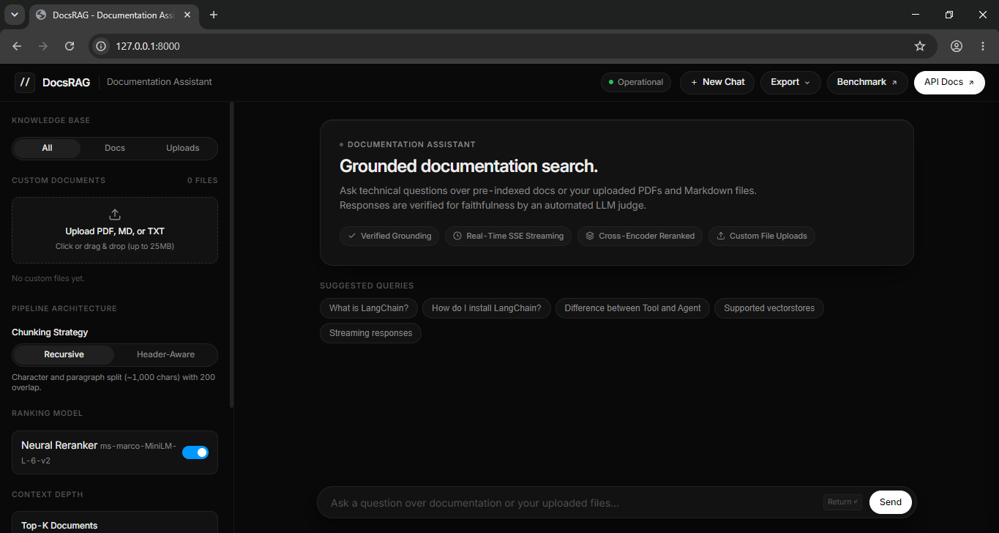
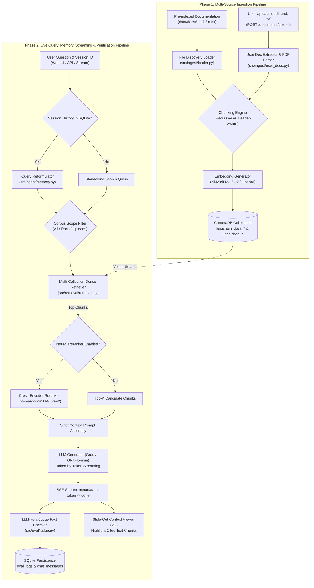

# DocsRAG

<p align="center">
  <strong>Production-Grade Retrieval-Augmented Documentation Assistant</strong><br>
  <em>Featuring Custom Document Ingestion, Multi-Turn Memory, Real-Time SSE Streaming, Neural Reranking, In-App Context Viewer, and LLM-as-a-Judge Verification</em>
</p>

<p align="center">
  <a href="https://www.python.org/downloads/"></a>
  <a href="https://fastapi.tiangolo.com/"></a>
  <a href="https://www.trychroma.com/"></a>
  <a href="https://huggingface.co/sentence-transformers"></a>
  <a href="https://groq.com/"></a>
  <a href="https://developer.mozilla.org/en-US/docs/Web/API/Server-sent_events"></a>
  <a href="https://docs.pytest.org/"></a>
</p>

---

## 📸 Output & Web Interface

DocsRAG includes a built-in, Framer-inspired minimalist dark-canvas Web UI for live technical querying, file uploading, dynamic pipeline reconfiguration, and real-time verification telemetry.

<p align="center">
  
</p>

<p align="center"><em>DocsRAG Production Web Interface: Multi-collection knowledge base scope switcher, custom document drag-and-drop dropzone, real-time SSE token streaming, slide-out document context reader with chunk highlighting, groundedness validation, and export menu.</em></p>

---

## 🌟 Overview

**DocsRAG** is an end-to-end, production-style Retrieval-Augmented Generation (RAG) system engineered to answer complex questions across technical documentation repositories and user-uploaded files with **mathematically verified, cited, and schema-validated responses**.

Standard RAG systems often hallucinate, retrieve out-of-context chunks, fail on conversational follow-ups, or lack source verification. DocsRAG solves these failure modes through an **"Open-Book Examination"** architecture:

1. **Multi-Source Ingestion Pipeline:** Indexes pre-existing documentation and user-uploaded `.pdf` (via page-aware `pypdf`), `.md`, and `.txt` files into dual Chroma collections using **Recursive Character Splitting** and **Markdown Header-Aware Semantic Splitting**.
2. **Dense Vector & Multi-Collection Retrieval:** Searches across base documentation and user uploads simultaneously with cosine distance normalization.
3. **Multi-Turn Conversational Memory (2A):** Tracks conversation sessions in SQLite, reformulating ambiguous follow-up queries (e.g., *"When was it developed and by whom?"*) into standalone search queries before vector lookup.
4. **Cross-Encoder Neural Reranking:** Filters false positives by rescoring candidate pairs using `cross-encoder/ms-marco-MiniLM-L-6-v2`.
5. **Real-Time Token Streaming (2B):** Delivers incremental response tokens over Server-Sent Events (`POST /ask/stream`) for sub-second perceived latency.
6. **Strict Context-Grounding:** Synthesizes answers under zero-hallucination prompts with inline chunk-level citations (`[file.md#chunk]`).
7. **LLM-as-a-Judge Verification:** Automatically fact-checks generated answers against retrieved source context to produce an objective **faithfulness score** (0.0 to 1.0).
8. **Slide-Out Full-Document Context Viewer (2D):** 1-click in-app drawer that opens directly from citation badges, source cards, or uploaded files, automatically scrolling to and highlighting the exact cited chunk.
9. **Chat Session Export (2F):** Client-side export to formatted Markdown reports (`.md`) and machine-readable JSON audit logs (`.json`).

---

## 🚀 Key Features

| Feature | Description | Component |
|---|---|---|
| **Custom Document Upload** | Drag-and-drop multi-file upload for `.pdf`, `.md`, and `.txt` files with automatic text extraction, chunking, and isolated Chroma vector indexing. | `src/ingest/user_docs.py` |
| **Knowledge Base Scope Switcher** | Segmented control to target queries across **All** (docs + uploads), **Docs** (documentation only), or **Uploads** (user files only). | `src/api/index.html` |
| **Multi-Turn Memory (2A)** | Conversation history persistence in SQLite with automated query reformulation for seamless follow-up questions. | `src/agent/memory.py` |
| **Real-Time SSE Streaming (2B)** | Token-by-token generation via Server-Sent Events with structured `metadata`, `token`, and `done` payload events. | `src/api/main.py` |
| **Slide-Out Context Viewer (2D)** | In-app reader opening from citation badges, auto-scrolling to and highlighting cited text chunks with path-traversal security guards. | `src/api/index.html` |
| **Chat Session Export (2F)** | 1-click export of chat sessions into formatted Markdown reports (`.md`) or structured JSON audit logs (`.json`). | `src/api/index.html` |
| **Dual Chunking Pipeline** | Switch between fixed-size recursive chunking (`1,000` chars, `200` overlap) and structural header-aware chunking (`#`, `##`, `###`). | `src/ingest/chunker.py` |
| **Dense Vector Retrieval** | High-performance embedding and cosine similarity search over ChromaDB collections. | `src/retrieval/retriever.py` |
| **Neural Cross-Encoder** | Deep relevance reranking using `ms-marco-MiniLM-L-6-v2` to filter top candidates before generation. | `src/retrieval/reranker.py` |
| **Grounded Answer Generator** | OpenAI `gpt-4o-mini` or ultra-fast free `Groq` (`llama-3.3-70b-versatile`) generation with strict citation rules. | `src/generation/generator.py` |
| **LLM-as-a-Judge** | Automated evaluator that audits answers against source chunks and computes faithfulness. | `src/eval/judge.py` |
| **Autonomous Agent Loop** | Multi-hop iterative reasoning using OpenAI function-calling with the `retrieve_docs` tool. | `src/agent/loop.py` |
| **Full Audit Trail** | Persistent SQLite store logging every query, answer, grounding verdict, latency profile, and chat message. | `src/eval/logger.py` |

---

## 🏗️ System Architecture

DocsRAG operates across two synchronized phases: **Ingestion (Offline & Dynamic Uploads)** and **Live Query (Retrieval, Memory, Streaming & Verification)**.



---

## 🕹️ Interaction Modes

DocsRAG offers four distinct ways to interact with the system:

### 1. Interactive Web Dashboard
Launch the server and navigate to `http://localhost:8000` in your browser. The web interface provides:
- **Knowledge Base Scope Switcher:** Seamlessly target queries across **All**, **Docs**, or **Uploads**.
- **Custom Documents Drag & Drop:** Upload PDFs, Markdown, and text files directly, with live chunk metrics and 1-click deletion.
- **Real-Time Token Streaming:** Watch responses materialize token-by-token with sub-second perceived latency.
- **Slide-Out Context Viewer (2D):** Click any citation tag or source card to inspect the full document context with highlighted chunks.
- **Top Navigation Controls:** `+ New Chat` to reset context, and `Export` to download Markdown reports (`.md`) or JSON audit logs (`.json`).
- **Pipeline Controls:** Toggle between **Recursive** and **Header-Aware** chunking, enable/disable the **Neural Cross-Encoder Reranker**, and adjust **Top-K Context Depth**.

### 2. Command-Line Assistant (`ask.py`)
Query documentation instantly from your terminal without opening a browser:

```bash
# Direct one-shot question
python ask.py "How do I install LangChain?"

# Interactive terminal session
python ask.py
```

### 3. REST & SSE Streaming API
Integrate DocsRAG with programmatic HTTP clients.

#### Standard Synchronous Query (`POST /ask`)
```bash
curl -X POST http://localhost:8000/ask \
  -H "Content-Type: application/json" \
  -d '{
    "question": "What is LCEL?",
    "chunking": "recursive",
    "corpus": "all",
    "use_reranker": true,
    "top_k": 5
  }'
```

#### Real-Time SSE Token Stream (`POST /ask/stream`)
```bash
curl -N -X POST http://localhost:8000/ask/stream \
  -H "Content-Type: application/json" \
  -d '{
    "question": "How do I create a custom tool?",
    "session_id": "session-123",
    "corpus": "all"
  }'
```

### 4. Autonomous Agent Loop (`src.agent.loop`)
Use DocsRAG inside Python workflows as an autonomous research agent:

```python
from src.agent.loop import agent_answer

result = agent_answer("How do I stream token responses from an LLM chain?")
print("Answer:", result.answer)
print("Grounded:", result.grounded)
print("Sources:", [s.doc_id for s in result.sources])
```

---

## 🛠️ Quickstart Guide

### 1. Prerequisites
- Python **3.11+**
- Git
- An API key for **Groq** (100% Free & recommended) or **OpenAI**

### 2. Clone Repository & Setup Environment

```bash
# Clone the repository
git clone https://github.com/kalpit118/DocsRAG.git
cd DocsRAG

# Create virtual environment
python -m venv .venv

# Activate virtual environment
# Windows (PowerShell):
.\.venv\Scripts\Activate.ps1
# macOS / Linux:
source .venv/bin/activate

# Install dependencies
pip install -r requirements.txt
```

### 3. Configure Credentials

Copy `.env.example` to `.env`:

```bash
cp .env.example .env
```

Edit `.env` with your preferred AI provider:

```ini
# ==========================================
# Option A: Groq (Recommended - 100% Free & Fast)
# Get key: https://console.groq.com/keys
# ==========================================
GROQ_API_KEY=gsk_your_groq_api_key_here
CHAT_MODEL=llama-3.3-70b-versatile
EMBED_MODEL=all-MiniLM-L6-v2

# ==========================================
# Option B: OpenAI (Paid)
# ==========================================
# OPENAI_API_KEY=sk-your_openai_api_key_here
# CHAT_MODEL=gpt-4o-mini
# EMBED_MODEL=text-embedding-3-small

# Storage paths
CHROMA_DB_PATH=db/chroma
SQLITE_DB_PATH=db/eval.db
DOCS_PATH=data/docs
USER_UPLOADS_PATH=data/user_uploads
```

### 4. Ingest Base Documentation

Ingest documentation markdown files into ChromaDB (generates both `recursive` and `header_aware` collections):

```bash
python scripts/ingest.py
```

### 5. Launch the Application

Start the FastAPI application and Web UI:

```powershell
# Using the PowerShell helper script
.\run.ps1

# Or using Uvicorn directly
uvicorn src.api.main:app --reload --host 127.0.0.1 --port 8000
```

- **Web Dashboard:** [http://127.0.0.1:8000](http://127.0.0.1:8000)
- **Interactive Swagger API Docs:** [http://127.0.0.1:8000/docs](http://127.0.0.1:8000/docs)
- **Alternative ReDoc Docs:** [http://127.0.0.1:8000/redoc](http://127.0.0.1:8000/redoc)

---

## 📡 API Specification

| Method | Endpoint | Description |
|---|---|---|
| `POST` | `/ask` | Synchronous RAG query with retrieval, reranking, answering, and LLM verification. |
| `POST` | `/ask/stream` | Server-Sent Events (SSE) streaming endpoint returning real-time tokens and grounding audit. |
| `POST` | `/documents/upload` | Multipart file upload (`.pdf`, `.md`, `.txt`) indexed dynamically into ChromaDB. |
| `GET` | `/documents` | List uploaded user documents, file sizes, and indexed chunk counts. |
| `DELETE` | `/documents/{filename}` | Delete a user document and purge its embeddings from Chroma collections. |
| `GET` | `/documents/raw` | Secure raw document content retriever for the in-app context viewer. |
| `GET` | `/sessions/{id}/messages` | Retrieve conversation turn history for a session from SQLite. |
| `DELETE` | `/sessions/{id}` | Clear message history for a specific conversation session. |
| `GET` | `/eval/latest` | Retrieve recent retrieval accuracy and faithfulness runs from SQLite. |
| `GET` | `/health` | System operational health probe (`{"status": "ok"}`). |

---

## 🧪 Testing

DocsRAG includes a comprehensive automated test suite covering chunker boundary logic, vector search, reranking behavior, document upload/deletion, conversational memory query reformulation, raw text retrieval, and FastAPI endpoint contracts.

```bash
pytest tests/ -v
```

```text
tests/test_chunker.py::test_recursive_chunker PASSED
tests/test_chunker.py::test_header_aware_chunker PASSED
tests/test_api.py::test_health PASSED
tests/test_api.py::test_ask_endpoint PASSED
tests/test_new_features.py::test_upload_and_manage_documents PASSED
tests/test_new_features.py::test_raw_document_viewer_security PASSED
tests/test_new_features.py::test_chat_message_persistence PASSED
tests/test_new_features.py::test_query_reformulation PASSED
============================== 14 passed in 30.22s ===============================
```

---

## 📂 Project Structure

```text
DocsRAG/
├── assets/
│   └── webui.png              # UI screenshot and visual demonstration
├── data/
│   ├── docs/                  # Corpus of technical markdown docs (*.md, *.mdx)
│   └── user_uploads/          # Storage directory for user-uploaded custom files
├── db/
│   ├── chroma/                # Persistent vector database collections
│   └── eval.db                # SQLite store for query evaluations & chat messages
├── scripts/
│   ├── ingest.py              # Ingestion pipeline: load, split, embed, index
│   ├── evaluate.py            # Quick retrieval metrics runner
│   └── compare_configs.py     # Configuration comparison benchmark script
├── src/
│   ├── __init__.py
│   ├── llm.py                 # Multi-provider client (Groq, OpenAI, SentenceTransformers)
│   ├── agent/
│   │   ├── loop.py            # Multi-hop tool-calling agent (retrieve_docs)
│   │   └── memory.py          # Conversational memory & query reformulation engine
│   ├── api/
│   │   ├── main.py            # FastAPI REST & SSE endpoints
│   │   ├── schemas.py         # Pydantic v2 schemas (QueryRequest, RAGAnswer, etc.)
│   │   └── index.html         # Framer-style dark-canvas responsive web application
│   ├── eval/
│   │   ├── harness.py         # Hit@K and MRR computation engine
│   │   ├── judge.py           # LLM-as-a-Judge faithfulness scoring
│   │   └── logger.py          # SQLite database connection, query audit & chat history
│   ├── generation/
│   │   ├── generator.py       # Context assembly, streaming & LLM generation
│   │   └── prompts.py         # Grounding & Judge prompt templates
│   ├── ingest/
│   │   ├── loader.py          # Documentation file discovery & markdown loader
│   │   ├── chunker.py         # Recursive & Header-aware chunking implementations
│   │   ├── embedder.py        # Vector embedding generator & Chroma loader
│   │   └── user_docs.py       # Custom document parser (PDF/MD/TXT) & dynamic ingestion
│   └── retrieval/
│       ├── retriever.py       # ChromaDB multi-collection vector retrieval
│       └── reranker.py        # Sentence-Transformers Cross-Encoder
├── tests/                     # Automated unit and integration tests
├── ask.py                     # CLI assistant for terminal users
├── eval_qa.json               # 20 hand-crafted test questions with ground truth
├── pyproject.toml             # Project metadata & tool configuration
├── requirements.txt           # Production dependencies (including pypdf, python-multipart)
└── run.ps1                    # PowerShell launcher script
```

---

## 💻 Tech Stack

- **Framework:** [FastAPI](https://fastapi.tiangolo.com/), [Uvicorn](https://www.uvicorn.org/)
- **Vector Database:** [ChromaDB](https://www.trychroma.com/)
- **Document Processing:** [pypdf](https://pypi.org/project/pypdf/), [python-multipart](https://andrew-d.github.io/python-multipart/)
- **Embedding Models:** `all-MiniLM-L6-v2` / `text-embedding-3-small`
- **Reranker Model:** `cross-encoder/ms-marco-MiniLM-L-6-v2` via [Sentence-Transformers](https://sbert.net/)
- **Inference Providers:** [Groq](https://groq.com/) (Llama 3.3 70B, Qwen) & [OpenAI](https://openai.com/) (GPT-4o-mini)
- **Streaming:** Server-Sent Events (SSE)
- **Data Validation:** [Pydantic v2](https://docs.pydantic.dev/)
- **Persistence:** [SQLite](https://www.sqlite.org/)
- **Testing:** [Pytest](https://docs.pytest.org/), [HTTPX](https://www.python-httpx.org/)

---

## 📄 License

This project is open-source and available under the [MIT License](LICENSE).
